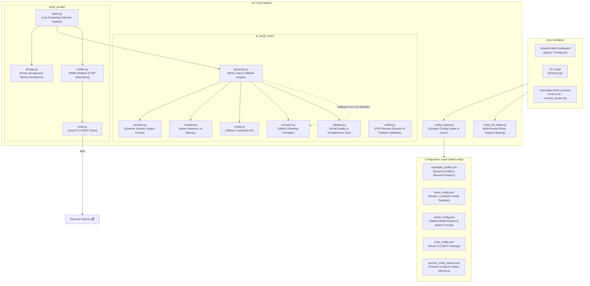

# AI Job Search & Auto-Apply

AI-powered cold email outreach and job application automation platform. It leverages local Large Language Models (DeepSeek-R1 via Ollama) to craft highly personalized, respectful, and recruiter-tailored emails, validates email quality and structure before dispatch, attaches your PDF resume, and tracks outreach history to prevent duplicate sends.

---

## 🏗️ System Architecture



---

## 📂 Project Structure

```
AI-Job-Search-Auto-Apply/
├── app.py                            # 🌐 Root Streamlit web launcher
├── pyproject.toml                    # 📦 Python project & dependencies (Requires Python >=3.10)
├── README.md                         # 📖 Documentation & guides
│
├── bin/                              # 🚀 Execution
│   ├── app.py                        # Main Streamlit dashboard (4 tabs)
│   └── main.py                       # CLI batch execution script
│
├── run/                              # ⚡ Automated Shell & Batch Launchers
│   ├── run.sh                        # Auto environment detector & Streamlit launcher
│   ├── mail_sender.sh                # Shell script with step progress tracker
│   └── mail_sender.bat               # Windows batch launcher
│
├── docs/                             # 📚 Documentation & Testing Notebooks
│   └── nb/
│       └── testing.ipynb             # 🧪 12-Chunk pipeline walkthrough & verification
│
├── tests/                            # ✅ Automated Test Suite
│   └── test_end_to_end.py            # End-to-end Pytest suite (Config, DB, AI, Sender, AppTest)
│
├── data/
│   └── config/                       # ⚙️ JSON Configuration Bucket
│       ├── candidate_profile.json    # Candidate background, skills & projects
│       ├── email_config.json         # Sender email, subject, template & lookback
│       ├── model_config.json         # Model parameters & custom system prompt
│       ├── smtp_config.json          # SMTP server connection settings
│       └── generic_email_names.json  # Prefixes to skip for personal name inference
│
└── src/                              # 🧩 Modular Source Code
    ├── config_loader.py              # Configuration loader & atomic saver helper
    ├── email_db_helper.py            # Multi-format parser, strict regex, backups & domain ops
    ├── ai_email_writer/              # 🤖 AI Generation & Quality Control
    └── email_sender/                 # 📤 Email Delivery & Protection
```

---

## 🚀 Quick Start & Prerequisites

1. **Python Environment**: Python 3.10 or higher.
2. **Ollama (Optional for AI Personalization)**:
   - Download and install [Ollama](https://ollama.com).
   - Pull the recommended local reasoning model:
     ```bash
     ollama pull deepseek-r1:1.5b
     ```
   - *Note*: If Ollama is offline or not installed, the application automatically applies a robust offline fallback using the generic body template.
3. **Gmail App Password (for SMTP sending)**:
   - Generate a 16-character application password from your Google Account:
     [Google App Passwords](https://myaccount.google.com/apppasswords)
   - Store credentials securely; never commit sensitive passwords or private keys to version control.

---

## 💻 How to Run the Project

### ⚡ Primary Shell File Command

The primary automated launcher is [`run/run.sh`](file:///c:/Users/javar/OneDrive/Desktop/test_app/backup11/AI-Job-Search-Auto-Apply/run/run.sh). It automatically:
1. Reads requirements (`requires-python = ">=3.10"`) from `pyproject.toml`.
2. Inspects your computer for an existing compatible Python environment (active Conda/virtualenv or system `python`).
3. Uses your existing Python environment directly (or automatically creates `.venv` if none exists).
4. Runs `pip install .` to ensure all packages are up-to-date.
5. Launches the Streamlit frontend.

---

### 🖥️ Running in Different Terminals

#### 1. Git Bash (Recommended for Windows)
```bash
bash run/run.sh
```
*Or grant execution permission and run directly:*
```bash
chmod +x run/run.sh
./run/run.sh
```

#### 2. Windows PowerShell
```powershell
& "C:\Program Files\Git\bin\bash.exe" run/run.sh
```
*Or if `bash` is in your Windows PATH:*
```powershell
bash run/run.sh
```

#### 3. Windows Command Prompt (CMD)
```cmd
"C:\Program Files\Git\bin\bash.exe" run/run.sh
```
*Or if `bash` is on your PATH:*
```cmd
bash run/run.sh
```

#### 4. Linux / macOS Terminal
```bash
chmod +x run/run.sh
./run/run.sh
```

#### 5. Windows Subsystem for Linux (WSL)
```bash
wsl bash run/run.sh
```

---

### ⚙️ Running via JSON Configuration (VS Code & NPM)

#### Option A: VS Code `tasks.json` (Recommended for IDE One-Click Run)
Create or update `.vscode/tasks.json` in the project root:

```json
{
    "version": "2.0.0",
    "tasks": [
        {
            "label": "Run AI Job Search & Auto-Apply",
            "type": "shell",
            "command": "bash",
            "args": ["run/run.sh"],
            "windows": {
                "command": "C:\\Program Files\\Git\\bin\\bash.exe",
                "args": ["run/run.sh"]
            },
            "group": {
                "kind": "build",
                "isDefault": true
            },
            "presentation": {
                "reveal": "always",
                "panel": "new"
            },
            "problemMatcher": []
        }
    ]
}
```
*To run:* Press `Ctrl + Shift + B` (or `Cmd + Shift + B` on macOS).

---

#### Option B: VS Code Debugger `launch.json`
Create or update `.vscode/launch.json` to launch the application with the Python debugger:

```json
{
    "version": "0.2.0",
    "configurations": [
        {
            "name": "Streamlit: AI Job Search App",
            "type": "debugpy",
            "request": "launch",
            "module": "streamlit",
            "args": [
                "run",
                "app.py",
                "--server.port=8501",
                "--server.headless=false"
            ],
            "console": "integratedTerminal",
            "justMyCode": true
        }
    ]
}
```
*To run:* Press `F5` in VS Code.

---

#### Option C: `package.json` Scripts (for Node.js / NPM toolchains)
If you manage scripts with npm or yarn:

```json
{
    "name": "ai-job-auto-apply",
    "version": "0.3.0",
    "scripts": {
        "start": "bash run/run.sh",
        "start:win": "\"C:\\Program Files\\Git\\bin\\bash.exe\" run/run.sh",
        "app": "python -m streamlit run app.py",
        "test": "pytest tests/test_end_to_end.py -v"
    }
}
```
*To run:*
```bash
npm run start
# on Windows cmd/powershell:
npm run start:win
```

---

### 📦 Manual Direct Python Execution

If you prefer to run Streamlit directly without the shell script:

```bash
# 1. Install dependencies from pyproject.toml
pip install .

# 2. Launch Streamlit
python -m streamlit run app.py
```

---

## 🖥️ Streamlit Frontend Dashboard Guide

The web dashboard is organized into 4 specialized tabs:

### 💬 Tab 1: Chat & Auto-Email
- **Resume Upload & Multi-Format Profile Extractor**: Supports **PDF**, **Word** (`.docx`, `.doc`), and **Plain Text** (`.txt`). Uses a dual-engine extraction architecture: primary **Pydantic LLM structured output**, with automatic **Regex & heuristic fallback** when Ollama is offline or unresponsive.
- **Recipient Database Location & Ingestion**:
  - Specify any database file (`.json`, `.csv`, `.xlsx`, `.txt`).
  - Native file browser dialog (`🗂️ Navigate & Choose File`) to load contacts directly into memory.
  - **In-Memory Ready Inspector**: Quickly inspect loaded recipient emails with the popover viewer (`👁️ View Emails Loaded in Memory`).
  - **Script Scraper & Auto-Backups**: Paste raw text or job descriptions to scrape emails. The system creates an immutable backup (`Email_Storage_<date>_<time>.json`) before adding new contacts.
- **Real-Time Streaming Outreach & Universal Fallback**: Streams progressive live progress per recipient:
  - Subject line length validation and mobile client truncation preview.
  - **Universal Fallback Engine**: If Ollama is offline, times out, or returns incomplete output, it automatically falls back to the generic/static outreach template with personalized salutations.
  - Live remaining count and delivery status.

### 🔍 Tab 2: Dynamic Subject, Body & System Prompt
- **Dynamic Subject Line**: Real-time length calculation and recommendations ($\le 60$ characters).
- **Quality Validator**: Tests the general body against the `EmailValidator` tool (detects unfinished sentences, missing signatures, or placeholder leaks like `[Insert Company]`).
- **Dynamic System Prompt**: Exposes profile attributes to the LLM while enforcing respectful tone, proper bullet points (`•`), and double newline paragraph separation.

### 🗄️ Tab 3: Database Manager (Modify & Delete Only)
- **Modify Contact Record**: Update recipient email addresses or adjust their last contacted timestamps.
- **Delete Contact Records**: Single, multi-select, or script-based deletion with double-confirmation safety checks.

### 🌐 Tab 4: Domain-Wise Email Viewer & Analytics
- **Analytics KPIs**: Total Emails, Unique Domains, Contacted Count, and Pending Contacts.
- **Domain Search & Filtering**: Filter contacts by company domain (e.g. `@google.com`, `@capgemini.com`).
- **Domain Actions**: Export domain contacts as CSV or perform safe bulk domain deletions.

---

## 🧪 Modular End-to-End Test Suite

### 1. Automated Pytest Suite
Run the full test suite covering configuration, database helpers, AI writer, email sender, and headless Streamlit AppTest:

```bash
pytest tests/test_end_to_end.py -v
```

### 2. Interactive Pipeline Jupyter Notebook
Open and run the step-by-step pipeline walkthrough:

```bash
jupyter notebook docs/nb/testing.ipynb
```
*(Also mirrored at `doc/nb/testing.ipynb` for convenience).*

The notebook breaks down the pipeline into 12 standalone executable chunks:
1. Path & Environment Setup
2. Configuration & Candidate Profile Loader
3. Resume Parsing & Profile Extraction
4. Recipient Ingestion & Strict Regex Validation
5. Recruiter Humanization & Name Inference
6. Dynamic System Prompt & Tone Engineering
7. AI Email Writer, Validator & Offline Fallback
8. Lookback Window & Anti-Spam Deduplication
9. MIME Multipart Email Assembly & PDF Attachments
10. Multi-Format Exports & Domain Analytics
11. Streaming Batch Outreach Generator
12. Streamlit Web App Headless Verification

---

## 🛡️ Reliability & Safety Guarantees

- **No Sensitive Data Leaks**: Passwords and application tokens are never hardcoded or tracked in version control.
- **Strict Email Validation**: RFC-compliant regex eliminates malformed addresses and invalid TLDs.
- **Versioned Backups**: Every ingestion automatically saves a timestamped backup before modifying recipient records.
- **Zero Accidental Sends**: Recipients contacted within the configurable lookback window are automatically skipped.
- **Two-Step Deletion Confirmation**: Interactive confirmation dialogues prevent accidental contact deletion.
